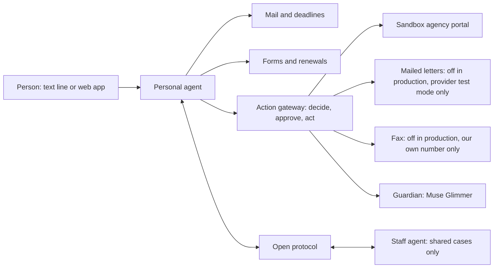

# Mano

[](https://github.com/mrcoven94/mano/actions/workflows/check.yml) [](LICENSE)

Mano is a text line for people renewing public benefits. Text it a photo of the letter. Mano finds the deadline that matters, fills out the renewal, and files it only after you say yes.

In April 2026, [Propel tested general-purpose AI agents on the online SNAP application](https://www.propel.app/insights/can-ai-agents-help-people-apply-for-snap-part-1/) in two states, in an internal test with no real applicants and nothing submitted. Both agents guessed what they had not been told, entered a mistyped phone number without asking, and ticked the legal checkbox themselves. Mano asks one plain question instead of guessing, leaves the declaration to the person, and has Muse Glimmer check every action before anything is filed.

Built for the Meta Global AI Developer Hackathon (October 26 to November 4, 2026). Synthetic people only: no real resident data, and demo submissions go only to our own sandbox agency portal, never to a real office.

## What runs today

The whole renewal runs on your machine with `pnpm judge`, on synthetic data, with each step labeled real or simulated.

On production, you can text Mano at (801) 920-3370. The conversation runs on Meta's open-weight model, Muse Spark Open, through OpenRouter or a Modal Shared Endpoint, both with zero data retention, because Meta's hosted API answers HTTP 402 (billing not set up, checked November 4, 2026). Muse Glimmer checks actions on our own GPU. Computer use calls Meta's hosted API, so it does not run on production while the 402 lasts. [PR 152](https://github.com/mrcoven94/mano/pull/152) would move it to Muse Spark Open and is still open. A texted photo is read on Muse Spark Open too, with on-device paper detection in place of SAM 3.1. Reading letters and keeping a person's answers on their profile are deployed and not confirmed live on a model. The whole renewal has not been confirmed on the current production build.

A plain letter usually gets a question that names the date, not a held deadline. The check in `packages/mail/src/gate.ts` holds a date only when the letter has one deadline sentence, in wording it allows, and no other date, and because it reads one sentence at a time it has known gaps, listed in `packages/mail/test/gate-letters.test.ts`, such as a Re: line naming another program. The synthetic letter in `pnpm judge` does hold its date. A scam letter gets the warning first, and a single date in it appears only as the letter's claim, to check with the office.

## Try it on the web, no login

[withmano.com/try](https://withmano.com/try) runs preset synthetic letters through the deployed agent, Engine, Guardian and sandbox portal, with buttons only, and lists every model call beside the steps. It stays off until Engine has `MANO_AGENT_URL` and `MANO_AGENT_SECRET`, and `MANO_TRY` in `apps/engine/wrangler.toml` stops it. When the daily cap is spent it says so.

## Run Maria's renewal in one command

You need Node 24 or newer and pnpm 10. No key, login or account is needed. From a fresh clone:

```sh
pnpm install
pnpm judge
```

The command runs nine steps in one process. Every line says `real` or `simulated` and names the Meta model behind it. It writes the letter photo, the portal's view of the filing and Maria's replay page to a folder it names.

- With no key, each model step uses its recorded response and says so, and the command exits 0. A recording answers only the input it was made for.
- With your own `META_MODEL_API_KEY` set, SAM 3.1 and Muse Spark 1.3 run live on Meta's API.
- If a live call fails (HTTP 402, for example), the step prints why, finishes on its recording when the recording matches, and stops otherwise. The command exits 1 either way.

Three parts are simulated even with a key. Guardian's verdict is recorded, because Muse Glimmer runs on our own GPU. A stand-in for Mano's computer posts the same values to the portal's form, because the desktop runs on our Modal account. Maria's yes is scripted, because she is synthetic. The text line and Mano's agent turn are left out, and the output says so. Engine's action gateway and the sandbox portal run from their real code, on in-memory stores.

Checked on macOS from a fresh clone and on Ubuntu in CI (`pnpm check`, which includes `packages/quality/test/judge-command.test.ts`). Windows is not tested.

## Each spine step and the Meta model behind it

Every model Mano calls at runtime is a Meta model. Seven spine steps below call one, and the other four are plain code.

| Spine step | Meta model | Where it runs | On production today | In `pnpm judge` |
| --- | --- | --- | --- | --- |
| Maria texts and Mano answers, with its tools | Muse Spark Open (open weights) | OpenRouter, zero-retention endpoints only, or a Modal Shared Endpoint | Running | Left out, Mano's words are printed |
| Crisis check, before the agent, on one short health question that the keyword floor flags | Muse Spark 1.3, then Muse Spark Open when that fails | Meta's hosted API, then OpenRouter | Deployed, on Muse Spark Open during the 402. A failed check counts as a crisis | Left out |
| Plain answer, when the agent cannot answer | Muse Spark 1.3, then Muse Spark Open when that fails | Meta's hosted API, then OpenRouter | Standby, on Muse Spark Open during the 402 | Left out |
| Finding the letter in the photo | SAM 3.1, or none during the 402 (on-device paper detection, plain code) | Meta's hosted API, or Mano's own code | Deployed, on-device during the 402, not confirmed live | Live with your key, else a recording |
| Reading the letter into cited fields | Muse Spark 1.3, or Muse Spark Open during the 402 | Meta's hosted API, or OpenRouter, zero-retention endpoints only, or a Modal Shared Endpoint | Deployed, on Muse Spark Open during the 402, not confirmed live on a model | Live with your key, else a recording |
| Filling the form with Mano's computer | Muse Spark 1.3 computer use | Meta's hosted API, driving a desktop on Modal | Not running, 402 | Stand-in |
| Guardian checks each action, before the question and again at the yes | Muse Glimmer 30B (open weights) | Our own GPU on Modal | Running, with a cold start of about 3 minutes | Recording |
| Holding the one deadline | None, plain code | `packages/mail/src/gate.ts` | Deployed. A plain letter usually gets a question naming the date | Real |
| Drafting the renewal from the profile and the letter | None for the form table, the agent turn above calls it | `apps/agent/agent/lib/forms.ts` | Deployed, with answers kept on the profile, not confirmed live on a model | Real form table |
| Maria's yes and the filing to the sandbox portal | None, plain code | `apps/engine/src/gateway` | Deployed, no filing confirmed on this build | Real code, scripted yes |
| Reminder the day before her interview | None, plain code | `apps/engine/src/deadlines.ts` | Deployed | Not in this run |

The route for agent turns is set in `apps/agent/agent/lib/muse.ts`. With `MANO_MODEL_PROVIDER=openrouter` and `OPENROUTER_API_KEY` set, a turn goes to `meta/muse-spark-open` with `provider: { zdr: true, data_collection: "deny" }` on every request. OpenRouter sees each request in flight. With either setting missing, a turn goes to `muse-spark-1.3` on Meta's API with `store: false`. Production has both set until Meta's billing works (see the November 3 entry in `docs/decisions.md`). The same two settings send Mail's page reads to the same model with the same pin (`packages/mail/src/model.ts`), and SAM 3.1 is not called on that path. Filling a form follows the same two settings (`apps/agent/agent/lib/computer-fill.ts`). That path has no hosted computer tool, so it never raises a safety check; `pnpm --filter @mano/computer probe:live` checks that the model can drive the desktop and spends model credit. `MANO_MODEL_PROVIDER=modal` with `MODAL_ENDPOINT_URL` and `MODAL_PROXY_TOKEN` sends turns and page reads to the same model on a Modal Shared Endpoint. No request carries a pin on this route: Modal states zero data retention for the endpoint type, and Modal sees each request in flight (see the November 4 entry in `docs/decisions.md`). Chosen with a setting missing or a URL off Modal's domain, it calls no model, and it does not fall back to another route. With `OPENROUTER_API_KEY` set as well, a Modal call that times out, gets a 429 or 5xx, or loses its connection goes to `meta/muse-spark-open` on OpenRouter under its pin, and a log line with fixed words says which route answered. Filling a form is unavailable on it.

These parts are not Meta model calls: the keyword crisis floor that every text passes through, on-device paper detection, the deadline gate and field checks, the scam screen, the form table, the voice guard, the action gateway and its local rules, the sandbox portal, reminders, link checks through Cloudflare DNS, message delivery through Blooio, storage in Durable Objects and R2, and HEIC conversion through Cloudflare Images. `pnpm judge` reads its synthetic letter with the `muse-spark-1.3-contributor` ID, which `AGENTS.md` allows only for synthetic data.

`pnpm spine:live` runs the same renewal on a deployed Mano instead: a new synthetic handle each run, signed turns to the agent, a filing on the sandbox portal, and the portal's own record of the confirmation number. It prints each step with its model and wall time, takes `--runs N`, `--lang es`, `--yes <word>` and `--json`, and exits non-zero when any step fails. It spends model credit, and its settings are in `packages/quality/.env.example`.

## Live versus in progress

<!-- status:start -->
| Piece | Status | URL | Last deploy |
| --- | --- | --- | --- |
| Site | live | https://withmano.com | ee85e48 success 2026-11-04 |
| Sandbox portal | live | https://sandbox.withmano.com/ | 9ae4296 success 2026-11-04 |
| Engine | live | https://engine.withmano.com/health | fa899d4 success 2026-11-04 |
| Channels | live | https://text.withmano.com/health | fa899d4 success 2026-11-04 |
| Guardian | live | no public URL | 5a6ba65 success 2026-11-03 |
| Quality | in progress | not deployed yet | none |
<!-- status:end -->

`node scripts/status.mjs` generates this table from each health URL and the latest deploy. A daily workflow warns when this copy is stale.

The site does not offer these pieces. This is what is true of each one today:

| Piece | True today |
| --- | --- |
| Mano's own email inbox | Not on `main`. The code is in [PR 149](https://github.com/mrcoven94/mano/pull/149), which is still open |
| Daily check for new help | On `main`, with sends off behind `MANO_DAILY_CHECK_SENDS`, so it texts no one |
| Waiting on hold | On `main` and off in production ([Engine's health page](https://engine.withmano.com/health) shows `calls: off`). It has only a fake provider, with no real provider code, and has placed no real call |
| Faxes and mailed letters | On `main` and off in production (the same page shows `fax: off` and `mail: off`). Faxes go only to our own number and letters only through a provider's test mode. No fax has been sent, and nothing has been mailed |
| Sharing a case with a caseworker | On `main`. It ran on production with a synthetic person and a played model, with no real text and no live model |
| Mano on the web | Live at [app.withmano.com](https://app.withmano.com). Sign-in codes reach only verified addresses until email sending is on. It does not yet share memory with a person's texts |
| iPhone app | The build is prepared and has not been made. It needs the maintainer's Apple account |

The estimate page in the spine in `AGENTS.md` is not built.

## What was built during the hackathon

All of this was written from October 26, 2026 onward, except what [Prior work](#prior-work) and `docs/third-party.md` list.



| Path | What it does |
| --- | --- |
| `apps/channels` | The text line on Cloudflare Workers: iMessage and SMS webhooks, one conversation per handle, and the plain answer when the agent cannot answer |
| `apps/agent` | The agent on Eve by Vercel: reads each text, keeps a profile, proposes actions through Engine, and fills out forms |
| `apps/engine` | The system of record on Cloudflare: one Durable Object per person, encrypted files in R2, deadlines, approvals, and the action gateway |
| `packages/mail` | Turns a photo into letters and cited fields, then holds one deadline or asks a question that names the date. It also screens for scams |
| `packages/computer` | The screenshot and mouse loop for Mano's computer. It fills forms and never files them |
| `packages/guardian` | Muse Glimmer on one Modal GPU, plus the local rules Engine runs first |
| `packages/persona` | Mano's voice, the voice guard, and the crisis floor that always names 988 and 911 |
| `packages/programs` | Sourced facts for SNAP, Medicaid and LIHEAP in eight states. `pnpm --filter @mano/programs verify-sources` fetches every source again |
| `packages/protocol` | The open message format for working a shared case. The spec is in `docs/protocol.md` |
| `packages/accounts` | One person, one account: phone and email sign-in, linking and merge |
| `packages/quality` | The answer-quality bench and `pnpm judge` |
| `apps/sandbox-portal` | The fake state benefits portal that every demo files to |
| `apps/site` | withmano.com |
| `apps/app` | The resident app in React Native with Expo |
| `apps/web` | One Cloudflare Worker that serves the app's web build, with email sign-in and chat with Mano's agent. A message is the same agent turn the text line runs. Run its checks with `pnpm --filter @mano/web check` |

Tests cover the three safety cases: a stale approval is refused (`apps/engine/test/sandbox-portal-contract.test.ts`), a timeout is reconciled before any retry (`apps/engine/test/blocker-7-single-flight.test.ts`), and a scam link is caught (`packages/quality/test/checks.test.ts`, `packages/mail/test/safety.test.ts`). The tests for asking instead of guessing and for the person's declaration are in `apps/agent/test/form-draft.test.ts` and `apps/engine/test/sandbox-portal-contract.test.ts`. The reasons behind each choice are in `docs/decisions.md`.

Guardian scales to zero when idle, and a check fails closed after 10 seconds. A check that finds Guardian cold refuses with "try again in a few minutes" and leaves it starting. To keep one GPU warm (about $1.95 an hour), run the `guardian-modal` workflow from `main` with `min_containers` set to 1.

## Run and deploy it yourself

What each app needs differs:

- `apps/site`: with no keys, the sign-in routes run on stand-ins and print which parts are not live.
- `apps/app`: it needs `EXPO_PUBLIC_ENGINE_URL` or `EXPO_PUBLIC_DEMO_MODE=true`, and otherwise shows "Mano is not configured". Demo mode uses recorded synthetic responses and says so on screen.
- `apps/sandbox-portal`: it needs [wrangler](https://developers.cloudflare.com/workers/wrangler/) installed globally, because `pnpm install` does not add it for that package.
- `apps/agent` and `apps/channels`: with no model key, a stand-in answers. The agent's turn route answers 503 without `ENGINE_URL` and `MANO_ENGINE_AGENT_TOKEN`.
- `apps/engine`: with no model key, it refuses to answer unless `MANO_ENV=development` is set, as in `apps/engine/.dev.vars.example`, and then uses a labeled stand-in.

```sh
pnpm install
pnpm check
pnpm --filter @mano/site dev
pnpm --filter @mano/sandbox-portal dev
EXPO_PUBLIC_DEMO_MODE=true pnpm --filter @mano/app start
```

Copy each app's `.env.example` to `.dev.vars` or `.env` to use your own keys. `META_MODEL_API_KEY=... pnpm --filter @mano/channels probe:live` checks Mano's voice against the real model with synthetic messages. To deploy your own copy, see the workflows in `.github/workflows/`.

The sandbox portal also serves the renewal under other layouts (`/layouts`): five fixed ones and one generated from any seed at `/scramble/<seed>/apply`. `MEASURE_PORTAL_URL=<portal> SANDBOX_PORTAL_DRAFT_TOKEN=... MEASURE_MODEL=standin pnpm --filter @mano/computer probe:live layouts` runs a fill on each and prints correct fields, wall time, steps and model per layout, read back from what the portal saved. The stand-in needs no key and measures no model; `MEASURE_MODEL=meta`, `open` or `route` spends credit (see `packages/computer/probe/layouts.probe.ts`).

## Held-out test

Not run yet. The Results session will publish the headline here after the final run: correct packets, missed deadlines, blocked unsafe actions, failures, cost and time.

## Team

David Coven decides what gets built and owns the accounts. The code is written with coding agents, and every model Mano itself calls at runtime is a Meta model.

- From October 26 to 29, Muse Code sessions built the first parts, one session per workstream.
- From October 29, one Claude Code session leads: it plans the work, briefs a builder agent for each workstream, reads every diff and merges.
- GPT Sol reviews every pull request at its current head, with a multi-model panel for changes that touch auth, personal data or anything that sends. Nothing merges on its author's word.
- `AGENTS.md` is the full operating manual, and anyone can run the same process.

## Prior work

The site's state-by-state counts of offices and services come from Front Door, an earlier product by the same author, through its open data API, as a static snapshot in `apps/site/lib/coverage.ts`. Program facts come from official sources in `packages/programs`, and renewal forms are defined in `apps/agent/agent/lib/forms.ts`. Front Door's code is not part of this repository.

## License

MIT
