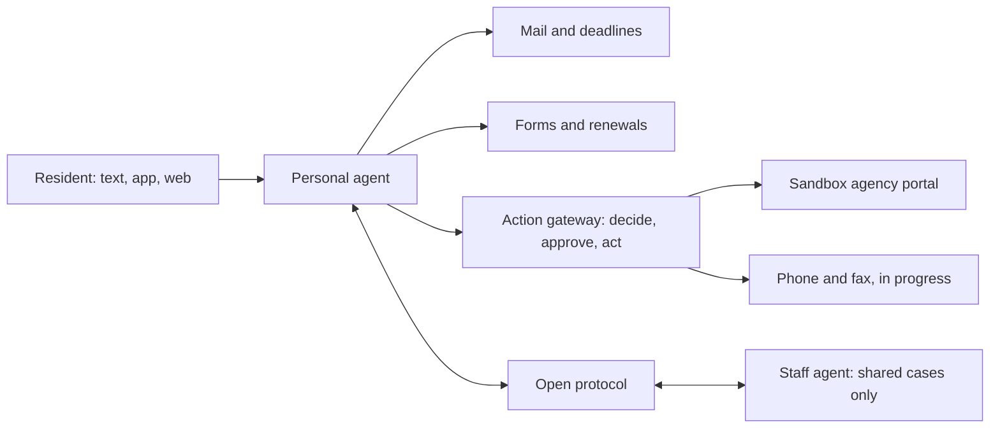

# Mano

[](https://github.com/mrcoven94/mano/actions/workflows/check.yml) [](LICENSE) [](https://github.com/mrcoven94/mano/releases)

Mano gives every person an agent that applies for help, fills out any form, reads their mail, renews on time and waits on hold. Agencies and nonprofits claim agents for their staff, and the agents work a shared case together only with the resident's consent. A person approves every decision.

Built for the Meta Global AI Developer Hackathon (October 26 to November 4, 2026) on Meta's Muse models. Everything in this repository was written from October 26, 2026 onward.

## Try it now

- Text Mano at (801) 920-3370. The current number is always on the site.
- Visit the site: [withmano.com](https://withmano.com).
- The resident app (iOS, Android, web) is in progress.

Demo submissions go to our own sandbox agency portal, our own phone lines and our own fax number. Synthetic people only, never real resident data.

## How it works

A resident talks to Mano by text, app or web. Their agent reads mail, tracks deadlines, fills out forms and drafts submissions. Every outside action goes through the action gateway: the agent decides, the person approves the exact version, then Mano acts. Staff agents at agencies and nonprofits see only the cases residents shared with them, and the agents coordinate over an open protocol.



## Live versus in progress

<!-- status:start -->
| Piece | Status | URL | Last deploy |
| --- | --- | --- | --- |
| Site | live | https://withmano.com | none |
| Sandbox portal | in progress | [Deployments panel](https://github.com/mrcoven94/mano/deployments) | none |
| Engine | in progress | not deployed yet | none |
| Channels | live | https://text.withmano.com/health | none |
| Guardian | in progress | not deployed yet | none |
| Quality | in progress | not deployed yet | none |
<!-- status:end -->

This table is generated by `scripts/status.mjs`, which checks each health URL and the latest deploy per environment. A scheduled workflow refreshes it and opens a pull request when it changes. Deployments are visible in the repository's [Deployments panel](https://github.com/mrcoven94/mano/deployments).

## Run it locally

You need Node 24 and pnpm. No accounts and no keys. Each package runs with local stand-ins when its keys are missing (a fake model client, an in-memory store, a local link check) and says which parts are not live.

```sh
pnpm install
pnpm check
```

Run the site:

```sh
pnpm --filter @mano/site dev
```

Run the sandbox agency portal (needs [wrangler](https://developers.cloudflare.com/workers/wrangler/)):

```sh
pnpm --filter @mano/sandbox-portal dev
```

Copy each app's `.env.example` to `.dev.vars` or `.env` to use your own keys. To deploy your own copy, see the deploy workflows in `.github/workflows/`.

## The text line

Texts to Mano land on `apps/channels`, a Cloudflare Worker. Each reply is a Meta model call to Muse Spark 1.3 (a Standard model ID with `store: false`, set as `MANO_REPLY_MODEL` in `apps/channels/wrangler.toml`). Mano's voice lives in `packages/persona` and goes to the model as its instructions, with the conversation as role messages.

- Simple questions take the fast path: one call at minimal reasoning effort, sent a second time 300 ms later, and the first answer wins. Replies arrive in about 2 to 4 seconds.
- Questions that need real digging take the deep path: the fast call returns a short heads-up, which is texted at once, then a second call at medium effort writes the full answer.
- Every outgoing text passes a deterministic voice guard (plain code, not a model call). It rewrites dashes and markdown, replaces any model or provider name with "I'm Mano, an automated assistant", and sends a short safe line instead of an empty text.
- A message about self-harm or danger never waits on a heads-up, and its reply always names 988 and 911.

Check the voice against the real model with your own key (synthetic messages only, sent to a `-contributor` model ID). Without a key, the probes are skipped:

```sh
META_MODEL_API_KEY=... pnpm --filter @mano/channels probe:live
```

## Packages and apps

| Path | What | Status |
| --- | --- | --- |
| `apps/site` | withmano.com: the public website and the resident and staff screens, on Vercel | live |
| `apps/sandbox-portal` | The fake state benefits portal every demo submits to, on Cloudflare Workers | live |
| `apps/engine` | The agent engine on Cloudflare: one agent per person and per organization, the action gateway | landing during the hackathon |
| `apps/agent` | The agent brain on Eve by Vercel: reads each text, remembers and proposes actions through the engine, keeps reminders | landing during the hackathon |
| `apps/channels` | The messaging worker on Cloudflare: webhooks, one conversation per handle, answers by text | live |
| `packages/channels` | The messaging library: the provider interface, the responder interface, turns and limits | live |
| `packages/persona` | Mano's voice: the soul, the fast and deep paths, the voice guard, the crisis floor and the persona probes | live |
| `packages/protocol` | The open message format agents use to work a case together | landing during the hackathon |
| `packages/guardian` | The checker that reviews every outside action before a person approves it | live |
| `packages/computer` | The desktop Mano drives: screenshots in, mouse and keyboard out, on Modal or local Playwright | landing during the hackathon |
| `packages/quality` | The nightly answer-quality bench | landing during the hackathon |
| `apps/app` | The resident app in React Native (iOS, Android, web) | landing during the hackathon |
| `eval` | The held-out test: scenarios, baselines and results | landing during the hackathon |
| `docs` | Decisions and design notes | live |

### Guardian

Guardian runs on one GPU on Modal and scales to zero when idle. A cold start takes about three minutes, and a check fails closed after 10 seconds, so Mano calls `warm()` when a conversation starts. To keep one GPU warm (about $1.95 an hour), run the `guardian-modal` workflow from `main` under Actions with `min_containers` set to 1. To turn it off, run it again with 0. Any merge that touches the guardian also deploys 0.

### Computer

`packages/computer` is the desktop Mano drives: a loop that shows the model a screenshot and executes the mouse and keyboard actions it returns. The hosted backend is a Modal Sandbox running a Linux desktop with Chromium (see `packages/computer/modal/`); the local stand-in drives Chromium through Playwright. The executor files a renewal on the sandbox portal through the computer and reconciles through the portal API. Logins go to the person through a live view; the agent never sees passwords. Details in the header comment of its `src/index.ts`.

## Held-out test

Not run yet. The Results session will publish the headline here after the final run: correct packets, missed deadlines, blocked unsafe actions, failures, cost and time.

## Team

David Coven decides what gets built and owns the accounts. The code is written with coding agents, and every model Mano itself calls at runtime is a Meta model.

- From October 26 to 29, Muse Code sessions built the first parts, one session per workstream.
- From October 29, one Claude Code session leads: it plans the work, briefs a builder agent for each workstream, reads every diff and merges.
- GPT Sol reviews every pull request at its current head, with a multi-model panel for changes that touch auth, personal data or anything that sends. Nothing merges on its author's word.
- `AGENTS.md` is the full operating manual, and anyone can run the same process.

## Prior work

Program, office and form data come from Front Door, an earlier product by the same author, through its partner API. Front Door's code is not part of this repository.

## License

MIT
