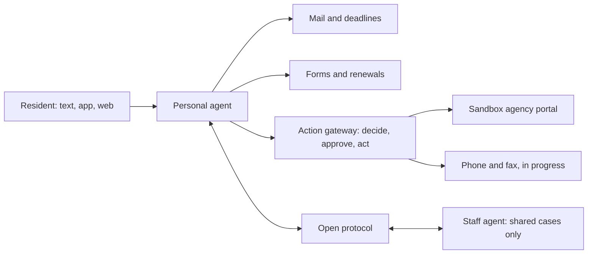

# Mano

[](https://github.com/mrcoven94/mano/actions/workflows/check.yml) [](LICENSE) [](https://github.com/mrcoven94/mano/releases)

Mano gives every person an agent that applies for help, fills out any form, reads their mail, renews on time and waits on hold. Agencies and nonprofits claim agents for their staff, and the agents work a shared case together only with the resident's consent. A person approves every decision.

Built for the Meta Global AI Developer Hackathon (October 26 to November 4, 2026) on Meta's Muse models. Everything in this repository was written from October 26, 2026 onward.

## Try it now

- Text Mano at (801) 920-3370. The current number is always on the site.
- Visit the site: [withmano.com](https://withmano.com).
- The resident app (iOS, Android, web) is in progress.

Demo submissions go to our own sandbox agency portal, our own phone lines and our own fax number. Synthetic people only, never real resident data.

## How it works

A resident talks to Mano by text, app or web. Their agent reads mail, tracks deadlines, fills out forms and drafts submissions. Every outside action goes through the action gateway: the agent decides, the person approves the exact version, then Mano acts. Staff agents at agencies and nonprofits see only the cases residents shared with them, and the agents coordinate over an open protocol.



## Live versus in progress

<!-- status:start -->
| Piece | Status | URL | Last deploy |
| --- | --- | --- | --- |
| Site | live | https://withmano.com | none |
| Sandbox portal | in progress | [Deployments panel](https://github.com/mrcoven94/mano/deployments) | none |
| Engine | in progress | not deployed yet | none |
| Channels | live | https://text.withmano.com/health | none |
| Guardian | in progress | not deployed yet | none |
| Quality | in progress | not deployed yet | none |
<!-- status:end -->

This table is generated by `scripts/status.mjs`, which checks each health URL and the latest deploy per environment. A scheduled workflow refreshes it and opens a pull request when it changes. Deployments are visible in the repository's [Deployments panel](https://github.com/mrcoven94/mano/deployments).

## Run it locally

You need Node 24 and pnpm. No accounts and no keys. Each package runs with local stand-ins when its keys are missing (a fake model client, an in-memory store, a local link check) and says which parts are not live.

```sh
pnpm install
pnpm check
```

Run the site:

```sh
pnpm --filter @mano/site dev
```

Run the sandbox agency portal (needs [wrangler](https://developers.cloudflare.com/workers/wrangler/)):

```sh
pnpm --filter @mano/sandbox-portal dev
```

Copy each app's `.env.example` to `.dev.vars` or `.env` to use your own keys. To deploy your own copy, see the deploy workflows in `.github/workflows/`.

## Packages and apps

| Path | What | Status |
| --- | --- | --- |
| `apps/site` | withmano.com: the public website and the resident and staff screens, on Vercel | live |
| `apps/sandbox-portal` | The fake state benefits portal every demo submits to, on Cloudflare Workers | live |
| `apps/engine` | The agent engine on Cloudflare: one agent per person and per organization, the action gateway | landing during the hackathon |
| `apps/channels` | The messaging worker on Cloudflare: webhooks, one conversation per handle, answers by text | live |
| `packages/channels` | The messaging library: the provider interface, the responder interface, turns and limits | live |
| `packages/protocol` | The open message format agents use to work a case together | landing during the hackathon |
| `packages/guardian` | The checker that reviews each action before it runs | landing during the hackathon |
| `packages/quality` | The nightly answer-quality bench | landing during the hackathon |
| `apps/app` | The resident app in React Native (iOS, Android, web) | landing during the hackathon |
| `eval` | The held-out test: scenarios, baselines and results | landing during the hackathon |
| `docs` | Decisions and design notes | live |

## Held-out test

Not run yet. The Results session will publish the headline here after the final run: correct packets, missed deadlines, blocked unsafe actions, failures, cost and time.

## Team

Three members: David Coven, Claude and Muse.

- David decides what gets built, owns the accounts and approves every merge.
- Claude is the architect. It plans the work, writes each build session's brief, orchestrates the sessions and reviews what they produce.
- Muse writes the code. Each part of Mano is built by a Muse Code session running Muse Spark, working from one brief and one ticket.
- Other models handle evaluation and review: an independent critique of every pull request from a model outside the build, plus a panel of open-weight models for changes that touch security, personal data or anything irreversible. A session never reviews its own work.

## Prior work

Program, office and form data come from Front Door, an earlier product by the same author, through its partner API. Front Door's code is not part of this repository.

## License

MIT
