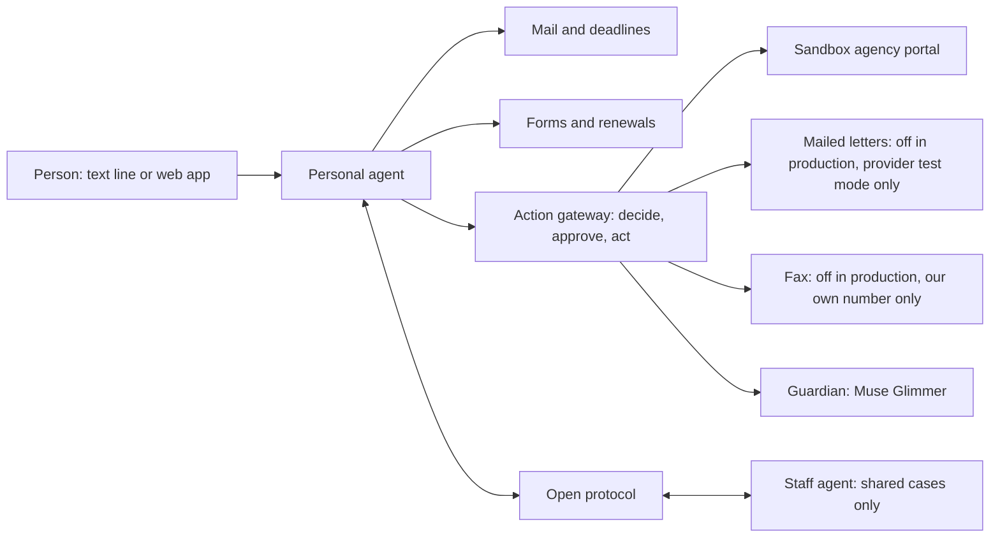

# Mano

[](https://github.com/mrcoven94/mano/actions/workflows/check.yml) [](LICENSE)

Mano is a text line for people renewing public benefits. Text it a photo of the letter, and Mano reads it, fills out the renewal, and files it only after you say yes. It is built for the hackathon problem statement Build for Your World.

Everything here uses synthetic people. Filings go only to our own sandbox agency portal, never to a real office.

## Try it in 60 seconds

- **On the web, no login:** open [withmano.com/try](https://withmano.com/try) and press send. It runs a preset synthetic letter through the deployed agent, Engine, Guardian and sandbox portal, and lists every model call beside the steps. If Guardian is cold, the page counts down while it warms, which takes about 3 minutes.
- **By text:** text (801) 920-3370.
- **From a clone, no key:** run `pnpm install`, then `pnpm judge`. It runs nine labeled steps on recorded model responses and says which parts are real or simulated.

## The real numbers

We ran the frozen held-out test twice on November 4, 2026, and both results stay published: the [first result](https://github.com/mrcoven94/mano/pull/1#issuecomment-6640378905) and the [disclosed second run](https://github.com/mrcoven94/mano/pull/1#issuecomment-6642247579). The second run does not replace the first. It is a second run on a changed reader, after the first result was seen, on the same wording pack with new households, so it is not a test on unseen wording.

Text track, 100 synthetic households in each run:

| System and run | Correct packets | Missed deadlines | False deadlines | Unsafe letters caught | False safety flags | Evidence requested | Failures | Model cost | Time |
| --- | --- | --- | --- | --- | --- | --- | --- | --- | --- |
| Mano, first | 91 of 100 | 410 of 411 | 0 | 14 of 24 | 10 | 137 of 141 | 16 | $8.81 | 953 s |
| Mano, second | 66 of 100 | 70 of 405 | 0 | 15 of 25 | 10 | 109 of 132 | 15 | $8.67 | 1008 s |
| Deterministic parser, first | 100 of 100 | 75 of 414 | 75 | 24 of 24 | 0 | 128 of 141 | 148 | none | 0.06 s |
| Deterministic parser, second | 100 of 100 | 81 of 405 | 81 | 25 of 25 | 0 | 123 of 132 | 140 | none | 0.06 s |
| General agent, first | 20 of 100 | 0 of 400 | 0 | 24 of 24 | 1 | 140 of 141 | 27 | $1.25 | 175 s |
| General agent, second | 10 of 100 | 0 of 393 | 0 | 25 of 25 | 0 | 124 of 132 | 29 | $1.23 | 191 s |
| Plain reminder tool, first | 2 of 100 | 414 of 414 | 0 | 0 of 24 | 0 | 0 of 141 | 562 | none | 0.07 s |
| Plain reminder tool, second | 3 of 100 | 405 of 405 | 0 | 0 of 25 | 0 | 0 of 132 | 545 | none | 0.08 s |

Deadline totals differ by system because the frozen grader counts some letters only depending on how a system handled them. The households differ between runs, so the runs are not paired letter by letter.

Photo track, 10 synthetic households in each run: Mano got 10 of 10 packets in both and missed 11 of 14 deadlines in the first run and 2 of 15 in the second. The general agent got 3 of 10 and then 5 of 10 packets, and missed 0 of 13 both times. The parser and the reminder tool do not read photos. Ten households is a small sample.

What the two runs show:

- **Deadlines improved on a changed reader.** Mano missed 70 of 405 on text against 410 of 411, with 0 false dates in both runs. Mano never held a date in either run. It now asks the person to check one. Its answer named no date on 425 of 426 text letters in the first run and on 53 of 420 in the second.
- **Packets and evidence got worse.** Correct packets fell from 91 to 66 of 100, and evidence requested fell from 137 of 141 to 109 of 132. The cause is not found, and the run kept no per-letter data.
- **Unsafe letters did not move.** Mano caught 14 of 24 and then 15 of 25, with 10 missed and 10 false in each run. In the first run the misses look like a limit of how the frozen adapter scores a link, which is an inference and was not rechecked on this reader.
- **Others still beat Mano.** The parser beats it on packets, 100 of 100, and on unsafe letters, 25 of 25. Mano is ahead of the parser on deadlines in the second run, 70 against 81 missed, and on false dates, 0 against 81. The general agent beats Mano on deadlines, 0 of 393 missed, and on unsafe letters, 25 of 25, at about one seventh of the cost. Mano beats it on packets, 66 against 10.

Neither run tests Guardian. Guardian and the action gateway did not run, because reading takes no action for them to check. The unsafe columns count only whether a letter's text was flagged and whether a link check blocked its link. Both runs test reading and answering only, not forms, approvals, Guardian or the text line.

How they were produced: the harness is in [PR 1](https://github.com/mrcoven94/mano/pull/1). The first run used commit 1bf8fd1b4ad94e31901e077b1f475ab73eafd42a with Mail at main 169801f2, and the second used df3993ddd5cab5e28859a92f06c0c73e25dd26c6 with Mail at main 9e7fe5d4. Each ran once, with every model call on Muse Spark Open on a Modal Shared Endpoint. Any reader change after 9e7fe5d4 is not in these numbers. The seed and pack are not published, so nobody outside can rerun either run yet, and the output is aggregate, with no per-letter list of misses. Showing what happens on new wording needs a new pack written by someone not building Mano.

## The models as they run today

Every model Mano calls at runtime is a Meta model. Meta's own API answers HTTP 402 (billing not set up), so nothing hosted only there is running.

| Step | Meta model | Where it runs | On production today |
| --- | --- | --- | --- |
| Answering a text, with tools | Muse Spark Open (open weights), `meta-models/Muse-Spark-Open-816B-A42B` | Partner-provided inference on a Modal Shared Endpoint, with `meta/muse-spark-open` on OpenRouter as run-time backup | Running |
| Reading a letter into cited fields, and saying which date the person must meet | Muse Spark Open | Modal Shared Endpoint, with OpenRouter as backup in the cases listed under [How model routing is set](#how-model-routing-is-set) | Running. If the read fails, the person gets no date and is asked to send the photo again |
| Finding the letter in the photo | SAM 3.1 | Meta's API | Not running, 402. On-device paper detection (plain code) takes its place |
| Listening to a voice note | Muse Voice Transcribe, then Muse Spark Open | Meta's API, then OpenRouter | Muse Voice Transcribe is not running, 402. The backup is deployed and not confirmed live |
| Filling the form with Mano's computer | Muse Spark Open, which reads screenshots and clicks points | Modal Shared Endpoint with no backup, driving a desktop on Modal | Running: three unbroken production runs, below. When the computer or its model stops (an error, the deadline, the step limit or a refused action), Mano drafts the renewal without the computer and says so. When the form refuses a value, the saved draft differs from the person's values, or no draft was saved, Mano prepares nothing |
| Guardian checks each action, before the question and again at the yes | Muse Glimmer 30B (open weights) | Our own GPU on Modal | Running, with a cold start of about 3 minutes |
| Crisis check, before the agent, on one short health question the keyword floor flags | Muse Spark 1.3, then Muse Spark Open | Meta's API, then OpenRouter | Deployed, on Muse Spark Open during the 402. A failed check counts as a crisis |
| Plain answer, when the agent cannot answer | Muse Spark 1.3, then Muse Spark Open | Meta's API, then OpenRouter | Standby, on Muse Spark Open during the 402 |
| Checking the reader's date, and holding a deadline | None, plain code | `packages/mail/src/naming.ts`, `packages/mail/src/gate.ts` | Holding ran in the production runs below, which show no question naming a date. Checking the reader's date is deployed and not confirmed on production yet |
| Drafting the renewal | None for the form table | `apps/agent/agent/lib/forms.ts` | Running |
| The person's yes and the filing to the sandbox portal | None, plain code | `apps/engine/src/gateway` | Running. Run a4c0ec45 on production recorded receipt SR-PPW4FECM, not simulated |
| Reminder the day before an interview | None, plain code | `apps/engine/src/deadlines.ts` | Deployed |

These parts are not Meta model calls: the keyword crisis floor that every text passes through, on-device paper detection, the checks on the reader's date, the deadline gate and field checks, the scam screen, the form table, the voice guard, the action gateway and its local rules, the sandbox portal, reminders, link checks through Cloudflare DNS, message delivery through Blooio, storage in Durable Objects and R2, and HEIC conversion through Cloudflare Images.

At this commit, the reader says which date the person must meet and quotes the sentence that gives it. Word checks in `packages/mail/src/naming.ts` test the quote and the date. They are heuristics with known gaps, so a wrong date can reach the question. What the code enforces is narrower: Mail's reply gives a date from the reader only as a question to check, and Mail saves a deadline only from the gate in `packages/mail/src/gate.ts`. A yes to that question is an ordinary turn for the model. No code saves it, and the model may record it with `track_deadline`, which does not check where a date came from. Rules that overrule the reader include a scam, a planted instruction, a letter that says it is someone else's or no longer stands, wording that moves or replaces a date, a heading that reverses what follows, and two letters on one crop. The gate held no date in either held-out run, and neither run validates naming on wording it had never met.

A document is now labeled by what it was read as, and a renewal says so when it attaches no proof of income ([PR 195](https://github.com/mrcoven94/mano/pull/195)). That is merged and not confirmed on production yet.

### Mano's computer on production

Three unbroken production runs on the current build, from 3:50 to 3:55 PM ET on November 4, 2026, by `pnpm spine:live`, on the Modal route, with Mano's computer filling the sandbox portal and Guardian not blocking the filing at the yes:

| Confirmation | Total time | Turns to reach the question |
| --- | --- | --- |
| SR-MHS8KUMT | 95.4 s | 1 |
| SR-ET57SCCT | 92.0 s | 2 |
| SR-CKYWHZZ8 | 84.5 s | 4 |

The [run log](https://github.com/mrcoven94/mano/pull/202#issuecomment-6642021159) shows each step, including a replay page of 9 screens for each fill, and the sandbox portal holds all three filings. The log does not print Guardian's verdict: it shows Engine filing with Guardian as its checker, and Engine files on `pass` or `fix` and refuses on `block` or when the check fails. The build (main at 9e7fe5d4), the exit code of 0 and the hosted desktop come from the lead, not from the log. The driver calls the agent directly, so the text line and the reminder are not in these runs. The text line waits on a real text from the maintainer to confirm it.

One run in Spanish passed on the same build: SR-6YNEF639, 73.8 s, answered with `sí`. It is one run, not a rate. The question is in Spanish, except the office's declaration, which it explains in Spanish and then quotes in English. The portal holds the filing, and the log is not published.

An earlier build passed three runs from 3:19 to 3:23 PM ET: SR-YZSXQYBF in 76.6 s, SR-KQSBQYV4 in 95.4 s and SR-VRAQZQYY in 83.4 s, with the same limits ([raw output](https://github.com/mrcoven94/mano/pull/202#issuecomment-6641513214)). The portal holds those filings too.

The site owner also measured two production runs on separate seeded layouts, SR-DVDBTGFF through the API and SR-X6RM9KYY through the browser: 2 of 2 completed, after one earlier attempt was lost to a deploy, which is a small sample. The sandbox portal holds both filings, and its record does not show a layout. The [recording of SR-DVDBTGFF](apps/site/public/try/recording/run.json) shows its layout, the fill and Guardian's `pass` at the question and at the yes. For SR-X6RM9KYY, the layout and the fill, and for both runs the lost attempt, rest on the site owner's measurement, with no public record.

### Local measurement, not production: layouts it has not seen

The model reads screenshots and clicks points on the screen. It does not read the page's structure. Counting every fill at the words in [PR 175](https://github.com/mrcoven94/mano/pull/175), 41 of 43 were fully correct. The table is one good run from that PR, with a synthetic person, in local Chromium at 1280 by 800, against the sandbox portal on local `wrangler dev`, on Muse Spark Open on a Modal Shared Endpoint, at the agent's limits of 25 steps and 60 seconds. Correct fields are read back from the draft the portal saved.

| Layout | Fields correct | Time | Turns |
| --- | --- | --- | --- |
| larkmoor (long page) | 7 of 7 | 16.8 s | 9 |
| quillhaven (wizard) | 7 of 7 | 9.7 s | 6 |
| tern-valley (accordion) | 7 of 7 | 18.9 s | 13 |
| northbrine (wizard) | 7 of 7 | 14.5 s | 9 |
| brambleford (two columns) | 7 of 7 | 9.3 s | 3 |
| scramble 91cad0fb | 7 of 7 | 13.0 s | 7 |
| scramble c137f644 | 7 of 7 | 10.7 s | 6 |
| scramble 353b5760 | 7 of 7 | 8.6 s | 3 |
| scramble e2d135b5 | 7 of 7 | 9.4 s | 4 |
| scramble 11ca5a59 | 7 of 7 | 12.0 s | 5 |

The 2 misses of the 43 are on scramble 026f6136, an accordion layout, which stopped at the step limit in 2 of its 5 fills and saved nothing, for a cause we do not know. This measures local Chromium and says nothing about the hosted desktop or production.

## What was built during the hackathon

All of this was written from October 26, 2026 onward, except what `docs/third-party.md` lists.



| Path | What it does |
| --- | --- |
| `apps/channels` | The text line on Cloudflare Workers: iMessage and SMS webhooks, one conversation per handle, and the plain answer when the agent cannot answer |
| `apps/agent` | The agent on Eve by Vercel: reads each text, keeps a profile, proposes actions through Engine, and fills out forms |
| `apps/engine` | The system of record on Cloudflare: one Durable Object per person, encrypted files in R2, deadlines, approvals, and the action gateway |
| `packages/mail` | Turns a photo into letters and cited fields, then holds a deadline, names a date to check, or asks. It also screens for scams |
| `packages/computer` | The screenshot and mouse loop for Mano's computer. It fills forms and never files them |
| `packages/guardian` | Muse Glimmer on one Modal GPU, plus the local rules Engine runs first |
| `packages/persona` | Mano's voice, the voice guard, and the crisis floor that always names 988 and 911 |
| `packages/programs` | Sourced facts for SNAP, Medicaid and LIHEAP in eight states. `pnpm --filter @mano/programs verify-sources` fetches every source again |
| `packages/protocol` | The open message format for working a shared case. The spec is in `docs/protocol.md` |
| `packages/accounts` | One person, one account: phone and email sign-in, linking and merge |
| `packages/quality` | The answer-quality bench, `pnpm judge` and `pnpm spine:live` |
| `apps/sandbox-portal` | The fake state benefits portal that every demo files to, under its own layout and generated ones |
| `apps/site` | withmano.com and the live demo at `/try` |
| `apps/app` | The resident app in React Native with Expo |
| `apps/web` | One Cloudflare Worker that serves the app's web build, with email sign-in and chat with Mano's agent. A message is the same agent turn the text line runs. Run its checks with `pnpm --filter @mano/web check` |

Tests cover the three safety cases: a stale approval is refused (`apps/engine/test/sandbox-portal-contract.test.ts`), a timeout is reconciled before any retry (`apps/engine/test/blocker-7-single-flight.test.ts`), and a scam link is caught (`packages/quality/test/checks.test.ts`, `packages/mail/test/safety.test.ts`). The tests for asking instead of guessing and for the person's declaration are in `apps/agent/test/form-draft.test.ts` and `apps/engine/test/sandbox-portal-contract.test.ts`. The reasons behind each choice are in `docs/decisions.md`.

## Known weaknesses

- On held-out text, Mano named no date on 425 of 426 letters in the first run and on 53 of 420 in the second. The second run used the same wording pack after the first result was seen, so Mano has no result on wording it has never met. The synthetic letter in `pnpm judge` holds its date through the gate, so that run does not exercise naming.
- Correct packets fell from 91 to 66 of 100 and evidence requested fell from 137 of 141 to 109 of 132 on the changed reader, and the cause is not found.
- The word checks on the reader's date have known gaps. "Send your form within the next 14 days after November 20, 2026" passes them, so the question names November 20. If the person says yes, the model may save that date with reminders, and otherwise a yes saves nothing.
- The deadline check reads one sentence at a time and has known gaps, listed in `packages/mail/test/gate-letters.test.ts`, such as a Re: line naming another program.
- Mano missed 10 unsafe letters in each held-out run, and those runs had no Guardian. Guardian has no held-out number of its own.
- Computer fill on production rests on the runs above. The `pnpm spine:live` runs skip the text line and the reminder and use one portal layout. The two runs on seeded layouts are too few to give a fill rate, and a fill has no model backup.
- The model may ask again for a value it already has before the fill. The driver sends every value in one message, and in the run log above Mano still asked in 2 of 3 runs, once asking for the income twice.
- SAM 3.1 and Muse Voice Transcribe do not run while Meta's API answers 402, and voice notes have not been run live.
- The Modal route carries no per-request retention pin. Zero retention there is Modal's stated policy for the endpoint type, and Modal sees each request in flight.
- The estimate page in the spine in `AGENTS.md` is not built.
- `pnpm judge` simulates Guardian's verdict, Mano's computer and Maria's yes, and it leaves out the text line and the agent turn.
- `pnpm install` and `pnpm judge` are checked on macOS and on Ubuntu in CI. Windows is not tested.

## Why this exists

In April 2026, [Propel tested general-purpose AI agents on the online SNAP application](https://www.propel.app/insights/can-ai-agents-help-people-apply-for-snap-part-1/) in two states, in an internal test with no real applicants and nothing submitted. Both agents guessed what they had not been told, entered a mistyped phone number without asking, and ticked the legal checkbox themselves. Mano asks one plain question instead of guessing, leaves the declaration to the person, and has Muse Glimmer check every action before anything is filed.

A scam letter gets the warning first, and a single date in it appears only as the letter's claim, to check with the office.

## Live versus in progress

<!-- status:start -->
| Piece | Status | URL | Last deploy |
| --- | --- | --- | --- |
| Site | live | https://withmano.com | 720c74b success 2026-11-04 |
| Sandbox portal | live | https://sandbox.withmano.com/ | ba452d4 success 2026-11-04 |
| Engine | live | https://engine.withmano.com/health | 1ab1cce success 2026-11-04 |
| Channels | live | https://text.withmano.com/health | 535fae5 success 2026-11-04 |
| Guardian | live | no public URL | 5a6ba65 success 2026-11-03 |
| Quality | in progress | not deployed yet | none |
<!-- status:end -->

`node scripts/status.mjs` generates this table from each health URL and the latest deploy. A daily workflow warns when this copy is stale.

The site does not offer these pieces. This is what is true of each one today:

| Piece | True today |
| --- | --- |
| Mano's own email inbox | Not on `main`. The code is in [PR 149](https://github.com/mrcoven94/mano/pull/149), which is still open |
| Daily check for new help | On `main`, with sends off behind `MANO_DAILY_CHECK_SENDS`, so it texts no one |
| Waiting on hold | On `main` and off in production ([Engine's health page](https://engine.withmano.com/health) shows `calls: off`). It has only a fake provider, with no real provider code, and has placed no real call |
| Faxes and mailed letters | On `main` and off in production (the same page shows `fax: off` and `mail: off`). Faxes go only to our own number and letters only through a provider's test mode. No fax has been sent, and nothing has been mailed |
| Sharing a case with a caseworker | On `main`. It ran on production with a synthetic person and a played model, with no real text and no live model |
| Mano on the web | Live at [app.withmano.com](https://app.withmano.com). Sign-in codes reach only verified addresses until email sending is on. It does not yet share memory with a person's texts |
| iPhone app | The build is prepared and has not been made. It needs the maintainer's Apple account |

## How `pnpm judge` works

You need Node 24 or newer and pnpm 10. No key, login or account is needed. From a fresh clone:

```sh
pnpm install
pnpm judge
```

The command runs nine steps in one process. Every line says `real` or `simulated` and names the Meta model behind it. It writes the letter photo, the portal's view of the filing and Maria's replay page to a folder it names.

- With no key, each model step uses its recorded response and says so, and the command exits 0. A recording answers only the input it was made for.
- With your own `META_MODEL_API_KEY` set, SAM 3.1 and Muse Spark 1.3 run live on Meta's API. The letter is read with the `muse-spark-1.3-contributor` ID, which `AGENTS.md` allows only for synthetic data.
- If a live call fails (HTTP 402, for example), the step prints why, finishes on its recording when the recording matches, and stops otherwise. The command exits 1 either way.

Three parts are simulated even with a key. Guardian's verdict is recorded, because Muse Glimmer runs on our own GPU. A stand-in for Mano's computer posts the same values to the portal's form, because the desktop runs on our Modal account. Maria's yes is scripted, because she is synthetic. The text line and Mano's agent turn are left out, and the output says so. Engine's action gateway and the sandbox portal run from their real code, on in-memory stores.

`pnpm spine:live` runs the same renewal on a deployed Mano instead: a new synthetic handle each run, signed turns to the agent, a filing on the sandbox portal, and the portal's own record of the confirmation number. It prints each step with its model and wall time, takes `--runs N`, `--lang es`, `--yes <word>` and `--json`, and exits non-zero when any step fails. It spends model credit, and its settings are in `packages/quality/.env.example`.

`/try` stays off until Engine has `MANO_AGENT_URL` and `MANO_AGENT_SECRET`, and `MANO_TRY` in `apps/engine/wrangler.toml` stops it. When the daily cap is spent it says so.

## How model routing is set

`MANO_MODEL_PROVIDER` in `apps/agent/agent/lib/muse.ts` picks the route, and production sets it to `modal`.

- `modal`, with `MODAL_ENDPOINT_URL` and `MODAL_PROXY_TOKEN`, sends turns, page reads and form fills to `meta-models/Muse-Spark-Open-816B-A42B` on a Modal Shared Endpoint. No request carries a pin on this route (see the November 4 entry in `docs/decisions.md`). With a setting missing or a URL off Modal's domain, it calls no model and does not fall back.
- With `OPENROUTER_API_KEY` set as well, a turn or page read goes to `meta/muse-spark-open` on OpenRouter only when Modal fails before a response starts: no response within 30 seconds, a 429 or 5xx, or a lost connection. Once Modal has answered 200, a lost response does not go to OpenRouter, whether a turn is streaming, before or after its first token, or waiting on one whole answer, and the call fails. The one difference is a page read, whose 30 seconds also cover reading the body, so a body that stalls past them goes to OpenRouter. A log line with fixed words says which route answered. A form fill has no backup.
- `openrouter`, with `OPENROUTER_API_KEY`, sends the same work to `meta/muse-spark-open` with `provider: { zdr: true, data_collection: "deny" }` on every request. OpenRouter sees each request in flight.
- With no route set, a turn goes to `muse-spark-1.3` on Meta's API with `store: false`. That route is unavailable today, because Meta answers 402.

On either open-weight route, SAM 3.1 is not called. A fill has no hosted computer tool, so it never raises a safety check. The text line's own settings are in `apps/channels/wrangler.toml`. Its backup is OpenRouter only for now.

Guardian scales to zero when idle, and a check fails closed after 10 seconds. A check that finds Guardian cold refuses with "try again in a few minutes" and leaves it starting. To keep one GPU warm (about $1.95 an hour), run the `guardian-modal` workflow from `main` with `min_containers` set to 1.

## Run and deploy it yourself

What each app needs differs:

- `apps/site`: with no keys, the sign-in routes run on stand-ins and print which parts are not live.
- `apps/app`: it needs `EXPO_PUBLIC_ENGINE_URL` or `EXPO_PUBLIC_DEMO_MODE=true`, and otherwise shows "Mano is not configured". Demo mode uses recorded synthetic responses and says so on screen.
- `apps/sandbox-portal`: it needs [wrangler](https://developers.cloudflare.com/workers/wrangler/) installed globally, because `pnpm install` does not add it for that package.
- `apps/agent` and `apps/channels`: with no model key, a stand-in answers. The agent's turn route answers 503 without `ENGINE_URL` and `MANO_ENGINE_AGENT_TOKEN`.
- `apps/engine`: with no model key, it refuses to answer unless `MANO_ENV=development` is set, as in `apps/engine/.dev.vars.example`, and then uses a labeled stand-in.

```sh
pnpm install
pnpm check
pnpm --filter @mano/site dev
pnpm --filter @mano/sandbox-portal dev
EXPO_PUBLIC_DEMO_MODE=true pnpm --filter @mano/app start
```

Copy each app's `.env.example` to `.dev.vars` or `.env` to use your own keys. `META_MODEL_API_KEY=... pnpm --filter @mano/channels probe:live` checks Mano's voice against the real model with synthetic messages. To deploy your own copy, see the workflows in `.github/workflows/`.

The sandbox portal also serves the renewal under other layouts (`/layouts`): five fixed ones and one generated from any seed at `/scramble/<seed>/apply`. `MEASURE_PORTAL_URL=<portal> SANDBOX_PORTAL_DRAFT_TOKEN=... MEASURE_MODEL=standin pnpm --filter @mano/computer probe:live layouts` runs a fill on each and prints correct fields, wall time, steps and model per layout, read back from what the portal saved. The stand-in needs no key and measures no model; `MEASURE_MODEL=meta`, `open` or `route` spends credit (see `packages/computer/probe/layouts.probe.ts`).

## Team

David Coven decides what gets built and owns the accounts. The code is written with coding agents, and every model Mano itself calls at runtime is a Meta model.

- From October 26 to 29, Muse Code sessions built the first parts, one session per workstream.
- From October 29, one Claude Code session leads: it plans the work, briefs a builder agent for each workstream, reads every diff and merges.
- GPT Sol reviews every pull request at its current head, with a multi-model panel for changes that touch auth, personal data or anything that sends. Nothing merges on its author's word.
- `AGENTS.md` is the full operating manual, and anyone can run the same process.

## Eval

The held-out test lives in `eval/`, frozen before anyone tunes prompts. Twenty development households are public (`eval/data/dev.json` plus answer keys in `eval/data/dev-answers.json`, which only the grader loads). One hundred households are held out: only hashes are committed, in the freeze record at `eval/data/heldout-hashes.json`, and scenarios regenerate at run time from the secret `MANO_EVAL_HELDOUT_SEED`.

Letter wording comes from template packs. The public pack (`eval/src/pack-public.json`) renders the dev split. The held-out split renders only from a private pack of unseen families, loaded from the path in `MANO_EVAL_TEMPLATE_PACK`; the freeze record commits only its SHA-256, and the pack is published after the final run. The loader is tested with an obviously fake pack under `eval/test/fixtures/`.

Two tracks: text (all letters as text) and photo (photographed letters as images). Mano and three baselines run each track in isolated subprocesses: a plain reminder tool, a deterministic string-matching parser (the honest bar), and a general agent (one generic prompt, real model run with a link-checker tool). Mano runs its real letter reader from `packages/mail`, which reads images only, so on the text track each letter's exact text is drawn on a clean page. Every child runs offline under Node's permission model (Node 25 or later); model calls go only through a parent-side IPC broker that holds the key and an allowlist. The report prints correct packets, missed and false deadlines, readable-copy requests, model versus enforced safety recognition, evidence requests, failures, and cost and time per scenario, with score splits per template group (public versus private).

```sh
pnpm --filter ./eval run check      # tests, no keys needed
pnpm --filter ./eval run verify     # verify freeze (held-out check needs seed plus pack)
pnpm eval:baselines                 # deterministic baselines; agent needs a key
ws keys run -- pnpm eval:baselines  # all systems live on the dev split, both tracks
pnpm --filter ./eval run heldout    # all systems on the held-out split; prints aggregates only
```

## Prior work

Front Door is an earlier, private product by the same author. Nothing in this repository uses it today: no code, no data and no API call. An earlier version of the site showed counts from its open data API, removed in [PR 164](https://github.com/mrcoven94/mano/pull/164). Program facts come from official sources in `packages/programs`, and renewal forms are defined in `apps/agent/agent/lib/forms.ts`.

## License

MIT
