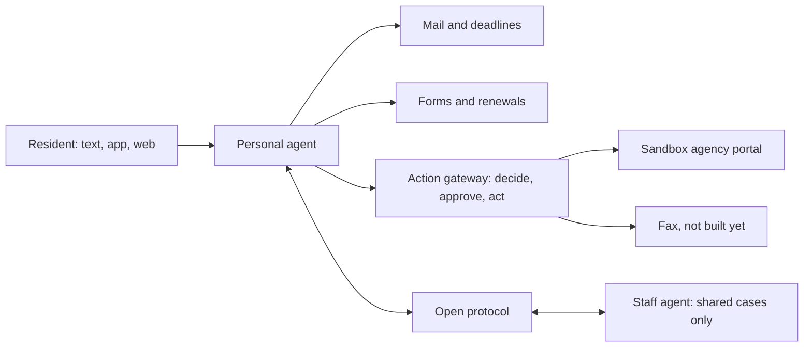

# Mano

[](https://github.com/mrcoven94/mano/actions/workflows/check.yml) [](LICENSE) [](https://github.com/mrcoven94/mano/releases)

Mano gives every person an agent that applies for help, fills out any form, reads their mail and renews on time. Agencies and nonprofits claim agents for their staff, and the agents work a shared case together only with the resident's consent. A person approves every decision.

Built for the Meta Global AI Developer Hackathon (October 26 to November 4, 2026) on Meta's Muse models. Everything in this repository was written from October 26, 2026 onward.

## Try it now

- Judges: run `pnpm install` and then `pnpm judge` from a fresh clone to watch Maria's renewal end to end on synthetic data (see [Judges](#judges-run-marias-renewal-in-one-command)).
- Text Mano at (801) 920-3370. The current number is always on the site.
- Visit the site: [withmano.com](https://withmano.com).
- The resident app (iOS, Android, web) is in progress.

Demo submissions go only to our own sandbox agency portal, never to a real office. Synthetic people only, never real resident data.

## How it works

A resident talks to Mano by text, app or web. Their agent reads mail, tracks deadlines, fills out forms and drafts submissions. It keeps one profile of the person (name, address, household, income, programs and case numbers), each fact marked with whether the person said it or a document showed it, so they never answer the same question twice. Every outside action goes through the action gateway: the agent decides, the person approves the exact version, then Mano acts. Staff agents at agencies and nonprofits see only the cases residents shared with them, and the agents coordinate over an open protocol.



## Live versus in progress

<!-- status:start -->
| Piece | Status | URL | Last deploy |
| --- | --- | --- | --- |
| Site | live | https://withmano.com | f846c8d success 2026-11-02 |
| Sandbox portal | live | https://sandbox.withmano.com/ | 5d854a0 success 2026-11-02 |
| Engine | live | https://engine.withmano.com/health | 80767ac success 2026-11-02 |
| Channels | live | https://text.withmano.com/health | 789eaf4 success 2026-11-02 |
| Guardian | live | no public URL | 25c099c success 2026-10-29 |
| Quality | in progress | not deployed yet | none |
<!-- status:end -->

This table is generated by `scripts/status.mjs`, which checks each health URL and the latest deploy per environment. A daily workflow posts the fresh table to its job summary and warns when this copy is stale; refresh it with `node scripts/status.mjs`. Deployments are visible in the repository's [Deployments panel](https://github.com/mrcoven94/mano/deployments).

## Judges: run Maria's renewal in one command

You need Node 24 and pnpm. From a fresh clone:

```sh
pnpm install
pnpm judge
```

Set `META_MODEL_API_KEY` in your environment first to run the Meta model steps live. The command runs Maria's renewal end to end on this machine, on synthetic data, with no login and none of our accounts. Maria texts a photo of a synthetic renewal letter. SAM 3.1 finds the letter in the photo and Muse Spark 1.3 reads it. Mano answers with the deadline and drafts the renewal from Maria's profile and the letter. Mano's computer fills the form on the sandbox portal. Engine's action gateway and Guardian check the action. The renewal carries her case number and ends with the office's declaration, which only Maria makes: before her yes, Engine refuses to file it. Maria says yes, and the portal receives the filing with her declaration. Without a key the run takes seconds; with one, the live letter reading adds about 30 seconds. The command writes the letter photo, the portal's view of the filing and Maria's replay page of each step to a folder it names.

Every step prints a label and says which parts ran for real and which were simulated, with the Meta model behind each part:

- Real: SAM 3.1 and Muse Spark 1.3 on Meta's API with your key, and Mano's own code, all in one process: the mail reader and its deadline gate, the agent's form table and approval question, Engine's action gateway and sandbox executor, the sandbox portal's request handler, and Engine's replay page.
- Simulated: Guardian's verdict (Muse Glimmer runs on our own GPU, so the run uses its recorded verdict), Mano's computer (Muse Spark 1.3 drives a hosted desktop on our Modal account, so a stand-in posts the same values to the portal's form and draws each screen), and Maria's yes (she is synthetic). Some parts of Mano are left out and labeled as such: the text line (the photo is handed to Mano directly and Mano's words are printed), Mano's agent turn (the run calls the form table its renewal tool uses), and Engine and the portal as deployed (their code runs here on in-memory stores). The saved replay page lists the same parts at the top.

Without a key, every model step uses its recorded response and says so. A recording answers only the input it was made for: the reading only the page SAM 3.1's recording found, and Guardian's verdict only the exact action it checked. A different input gets no recorded answer, and its step fails. If a live model call fails (for example HTTP 402), the step prints why, finishes on its recorded response, and the command exits 1. `pnpm --filter @mano/quality check` runs the same command both ways.

## Run it locally

You need Node 24 and pnpm. No accounts and no keys. Each package runs with local stand-ins when its keys are missing (a fake model client, an in-memory store, a local link check) and says which parts are not live.

```sh
pnpm install
pnpm check
```

Run the site:

```sh
pnpm --filter @mano/site dev
```

Run the sandbox agency portal (needs [wrangler](https://developers.cloudflare.com/workers/wrangler/)):

```sh
pnpm --filter @mano/sandbox-portal dev
```

Run the resident app with Expo:

```sh
pnpm --filter @mano/app start
```

Without `EXPO_PUBLIC_ENGINE_URL` the app talks to a stand-in engine with recorded synthetic responses and says so on screen; production refuses to start without the URL unless `EXPO_PUBLIC_DEMO_MODE=true`. `pnpm --filter @mano/app check` runs its typecheck, lint and tests.

Copy each app's `.env.example` to `.dev.vars` or `.env` to use your own keys. To deploy your own copy, see the deploy workflows in `.github/workflows/`.

## The text line

Texts to Mano land on `apps/channels`, a Cloudflare Worker. When the agent is configured (`AGENT_URL`, `MANO_AGENT_SECRET` and `MANO_HANDLE_GRANT_SECRET`), every text goes to an agent turn in `apps/agent`, where Muse Spark 1.3 answers with the agent's tools and Engine (Meta's open-weight Muse Spark Open through OpenRouter instead when `MANO_MODEL_PROVIDER=openrouter`, for testing while the Meta Model API is down). If the agent times out, fails or sends a reply Channels cannot use, or the person has asked to delete their conversation, the text line answers with its plain responder instead, which is also the only responder when the agent is not configured. The plain responder is a Meta model call to Muse Spark 1.3 (a Standard model ID with `store: false`, set as `MANO_REPLY_MODEL` in `apps/channels/wrangler.toml`). Mano's voice lives in `packages/persona` and goes to that model as its instructions, with the conversation as role messages.

- In the plain responder, simple questions take the fast path: one call at minimal reasoning effort, sent a second time 300 ms later, and the first answer wins. Replies arrive in about 2 to 4 seconds.
- In the plain responder, questions that need real digging take the deep path: the fast call returns a short heads-up, which is texted at once, then a second call at medium effort writes the full answer.
- Every outgoing text passes a deterministic voice guard (plain code, not a model call). It rewrites dashes and markdown, replaces any model or provider name with "I'm Mano, an automated assistant", and sends a short safe line instead of an empty text.
- A message about self-harm or danger never waits on a heads-up, and its reply always names 988 and 911.
- With `MANO_MODEL_PROVIDER=openrouter`, the agent reads each page of a texted letter with Meta's open-weight Muse Spark Open on zero-retention endpoints. SAM 3.1 runs only on Meta's API, so on this path it is not called: on-device paper detection (plain code) splits the photo, or the whole photo is read as one page. The deadline gate works the same.
- A photo texted as HEIC, HEIF or WebP is stored as a JPEG copy, so it can be attached to a form. Cloudflare Images makes the copy (an image service, not a model call) through the `IMAGES` binding in `apps/channels/wrangler.toml`. Without the binding the photo is stored as sent, Mano can still read it, and the reply asks for a screenshot.
- When the Meta Model API cannot answer the plain responder (HTTP 402, a 5xx or a timeout), the same call goes once to Meta's open-weight Muse Spark Open through OpenRouter, on zero-retention endpoints only (`zdr: true`, `data_collection: "deny"` on every request), and later texts skip the failing API for 5 minutes. The crisis check uses the same fallback. If both fail, Mano sends its short safe line, and a crisis message still gets 988 and 911 with no model at all. The fallback is off unless `OPENROUTER_API_KEY` is set for `apps/channels`.

Check the voice against the real model with your own key (synthetic messages only, sent to a `-contributor` model ID). Without a key, the probes are skipped:

```sh
META_MODEL_API_KEY=... pnpm --filter @mano/channels probe:live
```

With `OPENROUTER_API_KEY` set, the same command also sends one synthetic text to the open-weight fallback, with the Meta Model API played as down.

## Packages and apps

| Path | What | Status |
| --- | --- | --- |
| `apps/site` | withmano.com: the public website and the resident and staff screens, on Vercel | live |
| `apps/sandbox-portal` | The fake state benefits portal every demo submits to, on Cloudflare Workers | live |
| `apps/engine` | The agent engine on Cloudflare: one agent per person and per organization, the action gateway | landing during the hackathon |
| `apps/agent` | The agent brain on Eve by Vercel: reads each text, remembers and proposes actions through the engine, fills out forms on Mano's computer, keeps reminders and the deadlines Mano texts about on its own | landing during the hackathon |
| `apps/channels` | The messaging worker on Cloudflare: webhooks, one conversation per handle, answers by text | live |
| `packages/channels` | The messaging library: the provider interface, the responder interface, turns and limits | live |
| `packages/persona` | Mano's voice: the soul, the fast and deep paths, the voice guard, the crisis floor and the persona probes | live |
| `packages/protocol` | The open message format agents use to work a case together | landing during the hackathon |
| `packages/guardian` | The checker that reviews every outside action before a person approves it | live |
| `packages/computer` | The desktop Mano drives: screenshots in, mouse and keyboard out, on Modal or local Playwright | landing during the hackathon |
| `packages/quality` | The nightly answer-quality bench | landing during the hackathon |
| `packages/programs` | Sourced facts for SNAP, Medicaid and LIHEAP in eight states, which the agent looks up before stating any | landing during the hackathon |
| `packages/accounts` | One person, one account: phone and email sign-in, linking, merge, the account page | landing during the hackathon |
| `apps/app` | The resident app in React Native (iOS, Android, web) | landing during the hackathon |
| `eval` | The held-out test: scenarios, baselines and results | landing during the hackathon |
| `docs` | Decisions and design notes | live |

### Guardian

Guardian runs on one GPU on Modal and scales to zero when idle. A cold start takes about three minutes, and a check fails closed after 10 seconds, so Mano calls `warm()` when a conversation starts. Once Engine has `MANO_GUARDIAN_URL`, its action gateway runs Engine's local rules and then Guardian on every action, before the person is asked and again at their yes, and sends a warm-up with each check. A check that finds Guardian cold blocks with "try again in a few minutes" and leaves it starting. At the yes, a check that could not get Guardian's answer keeps the approval waiting and Engine marks the refusal `retryable`, so Mano asks the person to reply YES again in a few minutes and files it once. Guardian sees each action as Mano would send it, every value as written: the recipient, the purpose, every form field, text and claim, the cited sources with their quotes, and the consents on record. Nothing is removed first, so nothing can hide an attack from it. Guardian runs on our own GPU as a Modal Server in the app `mano-guardian-server`. Its code stores and logs no request or answer, and Modal passes a Server's requests and responses straight to the container without storing them. The earlier app, `mano-guardian`, is a web Function, and Modal keeps each input it receives for up to 7 days, so no copy is kept only once Engine has moved off it and it is stopped. The order: merge, which deploys the Server and prints its URL; copy that URL into the `MANO_GUARDIAN_URL` GitHub secret, its vault copy, and the agent's and quality nightly's copies; redeploy Engine; check that Engine's `/health` shows `checker: guardian` and run one live check; then run the `guardian-modal` workflow from `main` with `target` set to `stop-old`. A check that gets Modal's 503 retries once after a second when a full check still fits its 10 seconds, since the proxy can answer 503 for a moment after a container is ready. A personal form field that holds an email address or a link blocks the action before Guardian is asked. Engine's `/health` shows `checker: guardian`, or `local-rules` when none of the four `MANO_GUARDIAN_*` names is set. To keep one GPU warm (about $1.95 an hour), run the `guardian-modal` workflow from `main` under Actions with `min_containers` set to 1. To turn it off, run it again with 0. Any merge that touches the guardian also deploys 0. Every target is written to run only from `main`, since each holds production Modal credentials: each job's condition checks the ref, and its first step checks it again case-sensitively, because GitHub's `==` ignores case. Jobs carry no services, container or env that would see a secret before that step. The `guardian-check` workflow fails if the triggers, the guards or the keys a job may have change, which catches accidental edits on `main` and in reviewed pull requests. It cannot stop a hostile branch, which runs its own copy of both workflows; only the `guardian-production` environment's deployment branch policy, limited to `main` since November 3, 2026, closes that. To check a merged change on its own app before Engine's URL moves to it, run the workflow from `main` with `target` set to `staging`, which deploys `mano-guardian-staging` scaled to zero and prints its URL, then run it with `stop-staging`.

### Quality

Pull requests that can change what Mano says run the quality smoke: 28 synthetic cases through the real text line on a Meta model, gated against main's last nightly run. When the model provider refuses calls for billing (HTTP 402), the smoke and the nightly score nothing and report "model provider unavailable" in the job summary instead of failing. Any other error still fails. The `smoke-replay` job runs the same text line and safety checks on recorded synthetic replies with no key, so the code path stays covered while the provider is down: `pnpm --filter @mano/quality smoke-replay`. The letters suite is version 2: 26 full one-page notices from made-up county offices, drawn in code, three of them with a hedged date Mano should ask about instead of holding. Results from version 1 (three short lines per letter) compare only with a version 1 run: `pnpm --filter @mano/quality bench --suite letters --letters-version 1`.

### Computer

`packages/computer` is the desktop Mano drives: a loop that shows the model a screenshot and executes the mouse and keyboard actions it returns. The hosted backend is a Modal Sandbox running a Linux desktop with Chromium (see `packages/computer/modal/`); the local stand-in drives Chromium through Playwright. The desktop fills forms and never files them: filing goes through Engine's action gateway after the person's yes. Each fill keeps the screens it showed; Engine stores them encrypted for the person with the approval they produced, and the yes-or-no question links to a private page that replays each step, ends on the filled form and lists exactly what will be sent. A link opened after the draft changed says so and shows none of the old steps. A pending safety check stops the run and goes back to the caller, and a login prompt ends it, because there is no live view and the agent never sees passwords. Each desktop opens only the portal origin, mounts only its own person's profile, and answers only the caller holding its per-session secret. Details in the header comment of its `src/index.ts` and the docstring of `modal/app.py`; `modal run modal/prove.py` checks those rules live on throwaway Modal resources.

### Programs

`packages/programs` is the only place the agent gets program facts: the state's own name for SNAP, Medicaid and LIHEAP in California, Texas, New York, Florida, Illinois, Washington, Arizona and Ohio, what each covers, income limits by household size with their year, the renewal cycle, how to apply and the official phone and site. Every fact carries the official page it came from, the day it was checked and the text that shows it; anything not confirmed is listed in the entry's gaps. `pnpm --filter @mano/programs check` fails on a missing source or date or a site that is not official; `pnpm --filter @mano/programs verify-sources` fetches every source again and looks for each quote.

### Accounts

Texting Mano creates the account. The same person signs in on the web at `/sign-in` with that phone number (a 6-digit code by text) or with email through WorkOS, and manages sign-in methods at `/account`. Details live in the header comment of `packages/accounts/src/index.ts`; run its checks with `pnpm --filter @mano/accounts run check`.

## Held-out test

Not run yet. The Results session will publish the headline here after the final run: correct packets, missed deadlines, blocked unsafe actions, failures, cost and time.

## Team

David Coven decides what gets built and owns the accounts. The code is written with coding agents, and every model Mano itself calls at runtime is a Meta model.

- From October 26 to 29, Muse Code sessions built the first parts, one session per workstream.
- From October 29, one Claude Code session leads: it plans the work, briefs a builder agent for each workstream, reads every diff and merges.
- GPT Sol reviews every pull request at its current head, with a multi-model panel for changes that touch auth, personal data or anything that sends. Nothing merges on its author's word.
- `AGENTS.md` is the full operating manual, and anyone can run the same process.

## Prior work

The site's state-by-state counts of offices and services come from Front Door, an earlier product by the same author, through its open data API, as a static snapshot in `apps/site/lib/coverage.ts`. Program facts come from official sources in `packages/programs`, and renewal forms are defined in `apps/agent/agent/lib/forms.ts`. Front Door's code is not part of this repository.

## License

MIT
